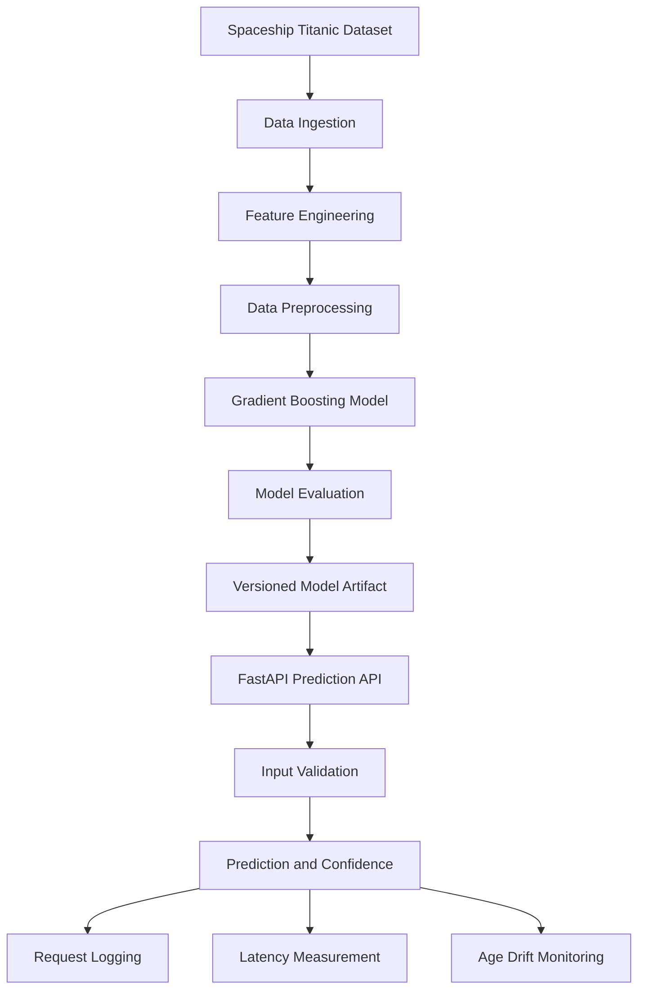

# 🚀 Spaceship Titanic Prediction API

A machine learning deployment project that predicts whether a passenger was transported to another dimension using the Spaceship Titanic dataset.

This project uses a **Gradient Boosting Classifier** and provides predictions through a REST API built with **FastAPI**. It also includes input validation, prediction logging, latency measurement, and basic data drift monitoring.

---

## 📌 Project Overview

The objective is to build a reproducible machine learning pipeline and expose the trained model through an API that can receive passenger information and return predictions.

### Key Features

- End-to-end machine learning training pipeline.
- Feature engineering and preprocessing.
- Gradient Boosting classification model.
- Versioned model artifact using Joblib.
- REST API built with FastAPI.
- Input validation using Pydantic.
- Prediction confidence scores.
- API request logging.
- Latency measurement and reporting.
- Basic Age feature drift monitoring.
- Model documentation through a Model Card.

---

## 🏗️ Project Architecture



---

## 📊 Model Performance

The model was trained and evaluated using the Spaceship Titanic dataset.

| Metric | Result |
|---|---:|
| Algorithm | Gradient Boosting Classifier |
| Training Samples | 6,954 |
| Validation Samples | 1,739 |
| Accuracy | 80.39% |
| ROC-AUC | 0.9058 |

### Confusion Matrix

```text
[[679, 184],
 [157, 719]]
```

The model achieved approximately **80.39% validation accuracy** and a **0.9058 ROC-AUC score**.

---

## ⚙️ Technology Stack

| Category | Technologies |
|---|---|
| Programming Language | Python |
| Data Processing | Pandas, NumPy |
| Machine Learning | Scikit-learn |
| API Framework | FastAPI |
| API Server | Uvicorn |
| Model Serialization | Joblib |
| Input Validation | Pydantic |
| API Testing | Swagger UI |
| Version Control | Git and GitHub |
| Development Environment | VS Code |

---

## 📁 Project Structure

```text
crunchy-data-scientist-t5-rudra_ya_10/
│
├── api/
│   └── main.py
│
├── artifacts/
│   └── models/
│       └── gradient_boosting_v1.joblib
│
├── data/
│   └── train.csv
│
├── logs/
│   └── prediction.log
│
├── monitoring/
│   ├── drift_monitor.py
│   └── logs/
│       └── drift_report.json
│
├── reports/
│   ├── training_metrics.json
│   └── LATENCY_REPORT.md
│
├── src/
│   ├── preprocessing.py
│   └── train.py
│
├── tests/
│
├── MODEL_CARD.md
└── README.md
```

---

## 🔄 Machine Learning Pipeline

The project follows these steps:

1. **Data Ingestion:** Load the Spaceship Titanic training dataset.
2. **Feature Engineering:** Extract passenger group information, cabin details, and total spending.
3. **Preprocessing:** Handle missing values, scale numerical features, and encode categorical features.
4. **Model Training:** Train a Gradient Boosting Classifier.
5. **Model Evaluation:** Evaluate using accuracy, ROC-AUC, and confusion matrix.
6. **Model Export:** Save the trained model as a versioned Joblib artifact.
7. **API Integration:** Load the saved model into the FastAPI application.

### Model Configuration

```python
GradientBoostingClassifier(
    n_estimators=150,
    learning_rate=0.1,
    max_depth=3,
    random_state=42
)
```

---

## 🌐 API Documentation

The project exposes a REST API using FastAPI.

### Available Endpoints

| Method | Endpoint | Description |
|---|---|---|
| GET | `/` | API health check |
| POST | `/predict` | Generate passenger prediction |
| GET | `/docs` | Interactive Swagger documentation |

### Run the API Locally

Activate the virtual environment:

```powershell
.\.venv\Scripts\Activate.ps1
```

Start the API server:

```powershell
python -m uvicorn api.main:app --reload
```

Open the following address in your browser:

```text
http://127.0.0.1:8000/docs
```

### Example Prediction Request

```json
{
    "PassengerId": "9999_01",
    "HomePlanet": "Earth",
    "CryoSleep": false,
    "Cabin": "G/100/P",
    "Destination": "TRAPPIST-1e",
    "Age": 30,
    "VIP": false,
    "RoomService": 100,
    "FoodCourt": 200,
    "ShoppingMall": 50,
    "Spa": 0,
    "VRDeck": 0,
    "GroupSize": 1
}
```

### Example API Response

```json
{
    "prediction": 0,
    "result": "Not Transported",
    "confidence": 0.6233,
    "latency_ms": 13.07
}
```

*Note: This is an illustrative response. Actual predictions, confidence scores, and latency values may vary.*

---

## 📈 Monitoring and Logging

### 1. Request Logging

The API records important prediction information, including:

- Input passenger information.
- Prediction result.
- Prediction confidence.
- Request timestamp.

Logs are stored in:

```text
logs/prediction.log
```

### 2. Data Drift Monitoring

The project implements basic drift monitoring for the `Age` feature.

- Training baseline mean Age: 28.83.
- Training baseline standard deviation: 14.49.
- Drift threshold: 20% change in mean.
- Monitoring batch size: 5 requests.

The system compares the mean Age of a batch of incoming requests against the training baseline.

Drift reports are stored in:

```text
monitoring/logs/drift_report.json
```

This is a basic monitoring implementation, not a complete production drift detection system.

### 3. Latency Measurement

The API measures prediction processing latency.

A local test was performed using 20 sequential requests.

| Metric | Result |
|---|---:|
| Total Requests | 20 |
| Average Latency | 13.07 ms |
| Minimum Latency | 9.11 ms |
| Maximum Latency | 38.45 ms |

Detailed results are available in:

```text
reports/LATENCY_REPORT.md
```

*Note: These measurements were collected locally and do not represent public deployment performance.*

---

## 📄 Model Documentation

The project includes a Model Card documenting:

- Intended use.
- Training dataset information.
- Model architecture and configuration.
- Evaluation results.
- Limitations and failure modes.
- Potentially affected groups.
- Out-of-scope use cases.
- Monitoring approach.
- Reproducibility information.

See:

```text
MODEL_CARD.md
```

---

## ▶️ Reproduce Model Training

After activating the virtual environment and installing the required dependencies, run:

```powershell
python -m src.train
```

The training pipeline saves:

- Trained model: `artifacts/models/gradient_boosting_v1.joblib`
- Evaluation metrics: `reports/training_metrics.json`

---

## ⚠️ Limitations

- The model is trained on the Spaceship Titanic dataset and may not generalize to unrelated datasets.
- Predictions depend on the quality and completeness of passenger input data.
- The reported performance is based on a validation split.
- Age drift monitoring uses a simple mean-based threshold.
- Latency measurements were collected in a local environment.
- Public deployment and production-scale load testing are not yet documented.

---

## 🔮 Future Improvements

- Public cloud deployment.
- Docker containerization.
- Automated model retraining.
- Advanced data drift detection.
- Automated API testing.
- Concurrent request and load testing.
- Model performance monitoring.
- CI/CD integration.

---

## 👨‍💻 Author

**Rudra Pratap Singh**

B.Tech Computer Science Student

Interested in Machine Learning, Data Science, and Model Deployment.

---

## 📌 Project Status

Core machine learning pipeline, FastAPI integration, input validation, logging, basic drift monitoring, and latency reporting have been implemented.

Public deployment, Dockerization, automated testing, and demo video are planned next.